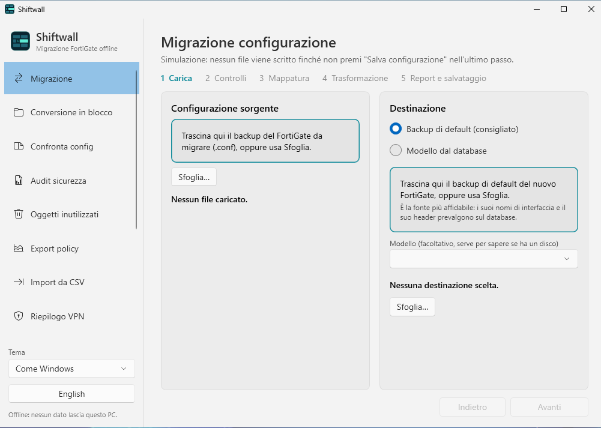

<p align="center">
  
</p>

<h1 align="center">Shiftwall</h1>

<p align="center">Migra le configurazioni FortiGate tra modelli diversi, offline, con una toolbox per sistemisti. Un unico exe portable per Windows, senza telemetria.</p>

<p align="center"><a href="README.md">English</a> · <b>Italiano</b></p>

<p align="center">
  <a href="https://github.com/BitJacker/shiftwall/actions/workflows/ci.yml"></a>
  <a href="https://github.com/BitJacker/shiftwall/releases/latest"></a>
  <a href="LICENSE"></a>
  
</p>

<!-- GIF demo: quando esiste assets/demo.gif (vedi docs/RECORDING.md), sostituisci lo screenshot qui sotto con
      -->
<p align="center">
  
</p>

## Perché Shiftwall

Sostituire un FortiGate con un modello diverso significa rinominare le interfacce in centinaia di riferimenti,
sistemare l'header e controllare che nulla punti a porte che il nuovo apparato non ha. Shiftwall lo fa con un wizard
guidato, mostra ogni modifica prima di scrivere qualsiasi file e non tocca mai i segreti cifrati. Funziona
completamente offline, quindi le configurazioni non lasciano il tuo PC, e ogni dato sui modelli viene da una fonte
ufficiale Fortinet.

## Funzioni

### Migrazione

- Wizard in cinque passi: caricamento, controlli, mappatura delle interfacce (per nome o con drag & drop),
  trasformazione, report e salvataggio.
- Destinazione da un backup di default (consigliato) o dal database dei modelli.
- Rinomina le interfacce in ogni riferimento e VDOM, rimuove le sezioni del disco sui modelli senza disco, sostituisce
  solo la sezione `config-version` dell'header, come nella procedura manuale Fortinet.
- Valida il risultato, mostra le differenze prima/dopo, esporta un report HTML, stampa in PDF e produce una checklist
  da verificare a mano.
- Template di mappatura riutilizzabili e conversione in blocco di più sedi, con modalità simulazione.
- I valori `ENC` (password, chiavi pre-condivise, chiavi private) sono copiati byte per byte e verificati dopo.

### Toolbox

- **Confronta config**: differenze per sezione.
- **Audit sicurezza**: 23 regole dalle Best Practices Fortinet e dalle RFC, ognuna con la sua fonte, e un punteggio.
- **Oggetti inutilizzati**: li trova e scrive uno script `delete`.
- **Export policy**: policy, indirizzi, gruppi, servizi, VIP e schedule in Excel o CSV.
- **Import da CSV**: indirizzi, servizi, relativi gruppi e VIP in uno script CLI, con validazione.
- **Riepilogo VPN**: fase 1 e 2 IPsec di una sede, o il confronto fra due sedi.
- **Anonimizza config**: per condividere una configurazione in sicurezza; una mappa protetta da password (AES-256-GCM)
  la ripristina.
- **Snippet CLI**: VLAN, policy, VIP, rotta statica e utente locale, come CLI pronta da rivedere.
- **Pianifica upgrade**: apre l'upgrade tool ufficiale Fortinet, senza percorsi inventati.
- **Backup da LAN** (facoltativo, disattivato di default): scarica un backup tramite la REST API di FortiOS da un
  indirizzo privato.

## Privacy

Shiftwall non invia dati. Funziona completamente offline.

| Shiftwall fa | Shiftwall non fa |
|---|---|
| Legge i file che apri e li elabora in memoria | Inviare telemetria, analytics o crash report |
| Scrive solo i file che salvi, mai sopra l'originale | Aggiornarsi da solo o contattare server |
| Conserva le impostazioni e un log degli errori senza contenuti delle config | Decifrare valori `ENC` o aggirare licenze e protezioni |
| Si collega a un FortiGate solo dalla pagina LAN, quando premi *Scarica* | Salvare il token API |

La build fallisce se codice fuori dal modulo LAN usa un client di rete. Dettagli: [SECURITY.md](SECURITY.md#privacy-policy).

## Download

**[Scarica Shiftwall.exe](https://github.com/BitJacker/shiftwall/releases/latest/download/Shiftwall.exe)** · [SHA256SUMS.txt](https://github.com/BitJacker/shiftwall/releases/latest/download/SHA256SUMS.txt)
· [tutte le release](https://github.com/BitJacker/shiftwall/releases)

> La versione 0.1.0 è una **pre-release**. I link "latest" di GitHub saltano le pre-release, quindi fino alla prima
> release stabile i due link qui sopra non funzionano: scarica i due file dalla [pagina delle release](https://github.com/BitJacker/shiftwall/releases).

Verifica il file prima di avviarlo. In PowerShell, nella cartella con i due file:

```powershell
(Get-FileHash .\Shiftwall.exe -Algorithm SHA256).Hash -eq (Get-Content .\SHA256SUMS.txt).Split(' ')[0]
```

`True` significa che il file è integro (il confronto ignora maiuscole e minuscole). L'exe non è firmato, quindi
SmartScreen mostra "Windows protected your PC": dopo aver verificato l'hash scegli *More info* → *Run anyway* (in
Windows in italiano le voci compaiono tradotte).

Istruzioni passo passo e l'elenco dei file che Shiftwall scrive: [docs/download-and-verify.md](docs/download-and-verify.md#scaricare-e-verificare-shiftwall).
Non servono installer né diritti di amministratore (circa 144 MB, Windows 10/11 x64).

## Avvio rapido

1. Verifica che i due apparati abbiano la **stessa versione di FortiOS** e fai il backup del vecchio e del nuovo
   (di default).
2. Avvia `Shiftwall.exe` e apri **Migrazione**.
3. Trascina il vecchio backup a sinistra e il backup di default del nuovo apparato a destra; leggi i controlli.
4. Premi **Mappa per nome** e completa la mappatura delle interfacce.
5. Controlla le modifiche, salva la nuova configurazione, segui la checklist e provala in laboratorio.

Guida completa: [docs/migration-guide.md](docs/migration-guide.md#guida-alla-migrazione).

## Provalo in 1 minuto

Non hai un FortiGate sotto mano? Usa i file sintetici in [samples/](samples/) (apri ogni file su GitHub e scegli
*Download raw file*):

1. **Migrazione**: trascina `branch-60f.conf` a sinistra e `factory-default-70g.conf` a destra; scegli il modello
   **FG-70G** nell'elenco sotto.
2. Vai al passo 3 e premi **Carica template…**: scegli `branch-60f-to-70g.swmap.json`.
3. Il passo 4 mostra il risultato: `internal5` diventa `port6`, la porta `dmz` non usata e le sezioni del disco sono
   rimosse, i valori `ENC` restano invariati. Nessun file viene scritto finché non premi *Salva configurazione*.
4. **Audit sicurezza**: carica `hq-60f.conf` per vedere i rilievi (accesso admin HTTP/Telnet, proposte IPsec deboli,
   NTP mancante) con le loro fonti.

## Modelli e versioni supportati

Generata dal database incluso. Ogni dato ha una fonte ufficiale Fortinet e una data di verifica in
[docs/SOURCES.md](docs/SOURCES.md). Con un backup di default della destinazione, qualsiasi modello può essere usato come
destinazione.

<!-- models:start (generated by update-db gen-docs, do not edit) -->
| Modello | Interfacce | Disco | Switch di default | FortiOS (release notes) |
|---|---|---|---|---|
| FG-100E | ✅ 22 | ⚠ | ⚠ | 6.2.0 – 7.2.14 |
| FG-100F | ✅ 28 | ✅ no | ⚠ | 6.2.4 – 8.0.2 |
| FG-101E | ✅ 22 | ⚠ | ⚠ | 6.2.0 – 7.2.14 |
| FG-101F | ✅ 28 | ✅ sì | ⚠ | 6.2.4 – 8.0.2 |
| FG-120G | ✅ 28 | ✅ no | ⚠ | 7.2.9 – 8.0.2 |
| FG-121G | ✅ 28 | ✅ sì | ⚠ | 7.2.9 – 8.0.2 |
| FG-200E | ✅ 20 | ⚠ | ⚠ | 6.2.0 – 8.0.2 |
| FG-200F | ✅ 28 | ✅ no | ⚠ | 6.4.7 – 8.0.2 |
| FG-200G | ✅ 28 | ✅ no | ⚠ | 7.4.8 – 8.0.2 |
| FG-201E | ✅ 20 | ⚠ | ⚠ | 6.2.0 – 8.0.2 |
| FG-201F | ✅ 28 | ✅ sì | ⚠ | 6.4.7 – 8.0.2 |
| FG-201G | ✅ 28 | ✅ sì | ⚠ | 7.6.4 – 8.0.2 |
| FG-30E | ⚠ | ⚠ | ⚠ | 6.2.0 – 6.2.17 |
| FG-30G | ✅ 4 | ✅ no | ⚠ | 7.4.10 – 8.0.2 |
| FG-31G | ✅ 4 | ✅ sì | ⚠ | 7.4.10 – 8.0.2 |
| FG-40F | ✅ 5 | ✅ no | ⚠ | 6.2.5 – 8.0.2 |
| FG-50E | ⚠ | ⚠ | ⚠ | 6.2.0 – 6.2.17 |
| FG-50G | ✅ 5 | ✅ no | ⚠ | 7.4.8 – 8.0.2 |
| FG-51G | ✅ 5 | ✅ sì | ⚠ | 7.4.8 – 8.0.2 |
| FG-60E | ⚠ | ⚠ | ⚠ | 6.2.0 – 7.4.13 |
| FG-60F | ✅ 10 | ✅ no | ⚠ | 6.2.4 – 8.0.2 |
| FG-61E | ⚠ | ⚠ | ⚠ | 6.2.0 – 7.4.13 |
| FG-61F | ✅ 10 | ✅ sì | ⚠ | 6.2.4 – 8.0.2 |
| FG-70F | ✅ 10 | ⚠ | ⚠ | 7.0.9 – 8.0.2 |
| FG-70G | ✅ 10 | ✅ no | ⚠ | 7.4.10 – 8.0.2 |
| FG-71F | ✅ 10 | ✅ sì | ⚠ | 7.0.9 – 8.0.2 |
| FG-71G | ✅ 10 | ✅ sì | ⚠ | 7.4.9 – 8.0.2 |
| FG-80E | ⚠ | ⚠ | ⚠ | 6.2.0 – 7.4.13 |
| FG-80F | ✅ 10 | ✅ no | ⚠ | 6.2.8 – 8.0.2 |
| FG-81E | ⚠ | ⚠ | ⚠ | 6.2.0 – 7.4.13 |
| FG-81F | ✅ 10 | ✅ sì | ⚠ | 6.2.8 – 8.0.2 |
| FG-90G | ✅ 10 | ✅ no | ⚠ | 7.2.9 – 8.0.2 |
| FG-91G | ✅ 10 | ✅ sì | ⚠ | 7.2.9 – 8.0.2 |
| FG-VM64 | ⚠ | ✅ sì | ⚠ | 6.2.0 – 8.0.2 |

✅ verificato da una fonte ufficiale · ⚠ non verificato (vedi [SOURCES.md](docs/SOURCES.md))
<!-- models:end -->

## Limiti noti

- Sorgente e destinazione devono avere la stessa versione di FortiOS: Shiftwall non traduce la sintassi tra versioni.
- Non si possono usare backup cifrati, in formato YAML o con password mascherate.
- I membri degli switch di default non sono documentati pubblicamente per la maggior parte dei modelli: carica il
  backup di default.
- I percorsi di upgrade non sono calcolati; viene aperto l'upgrade tool Fortinet.
- Testato su configurazioni sintetiche e file golden; la pagina LAN è stata provata con un server di test locale, non
  ancora con un FortiGate reale. Le segnalazioni da migrazioni reali (anonimizzate) sono benvenute.
- L'exe non è firmato; solo Windows (x64).
- Le config modificate non sono supportate dal TAC Fortinet.

## FAQ

Vedi [docs/faq.md](docs/faq.md#faq-italiano).

## Compilare dai sorgenti

Serve il [.NET SDK 10.0.404](https://dotnet.microsoft.com/download/dotnet/10.0) (fissato in `global.json`).

```bash
dotnet test -c Release
```

```bash
dotnet publish src/Shiftwall.App -c Release -o publish
```

L'app gira su Windows; librerie e test si compilano anche su Linux e macOS. Dettagli in [CONTRIBUTING.md](CONTRIBUTING.md).

## Roadmap

- Più modelli con elenco interfacce verificato, da fonti ufficiali e da nomi di interfaccia di backup di default
  forniti dalla community.
- Riscontri da migrazioni reali per ampliare controlli e checklist.
- Firma digitale dell'exe, per eliminare l'avviso di SmartScreen.
- Installazione con [winget](https://learn.microsoft.com/windows/package-manager/winget/), dopo la prima release stabile.

## Contribuire, licenza e disclaimer

I contributi sono benvenuti: leggi [CONTRIBUTING.md](CONTRIBUTING.md) e il [codice di condotta](CODE_OF_CONDUCT.md).
Segnala le vulnerabilità in privato come descritto in [SECURITY.md](SECURITY.md). Le modifiche sono elencate in
[CHANGELOG.md](CHANGELOG.md).

Shiftwall è software libero con licenza [GNU General Public License v3.0](LICENSE). Componenti di terze parti:
[THIRD-PARTY-NOTICES.md](THIRD-PARTY-NOTICES.md).

> Shiftwall non è affiliato a Fortinet. FortiGate e FortiOS sono marchi di Fortinet, Inc. Le config modificate non
> sono supportate dal TAC Fortinet: testare sempre in laboratorio prima della produzione.
