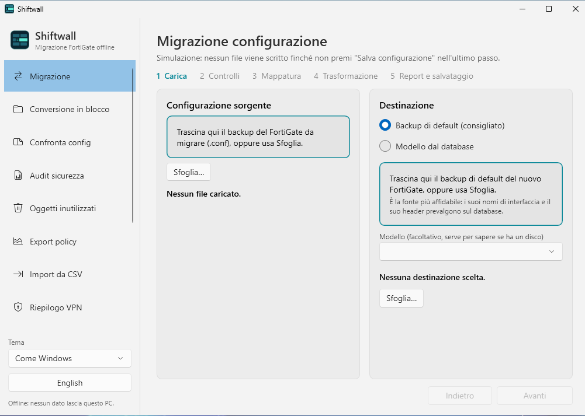

<p align="center">
  
</p>

<h1 align="center">Shiftwall</h1>

<p align="center">Migrate FortiGate configurations between models, offline, plus a sysadmin toolbox. One portable Windows exe, no telemetry.</p>

<p align="center"><b>English</b> · <a href="README.it.md">Italiano</a></p>

<p align="center">
  <a href="https://github.com/BitJacker/shiftwall/actions/workflows/ci.yml"></a>
  <a href="https://github.com/BitJacker/shiftwall/releases/latest"></a>
  <a href="LICENSE"></a>
  
</p>

<!-- Demo GIF: when assets/demo.gif exists (see docs/RECORDING.md), replace the screenshot below with
      -->
<p align="center">
  
</p>

## Why Shiftwall

Replacing a FortiGate with a different model means renaming interfaces in hundreds of references, fixing the header
and checking that nothing points to ports the new unit does not have. Shiftwall does this in a guided wizard, shows
every change before writing anything, and never touches encrypted secrets. It runs entirely offline, so configurations
never leave your PC, and every model datum it uses comes from an official Fortinet source.

## Features

### Migration

- Five-step wizard: load, pre-checks, interface mapping (by name or drag and drop), transform, report and save.
- Target from a factory-default backup (recommended) or from the model database.
- Renames interfaces in every reference and VDOM, removes disk sections on diskless targets, replaces only the
  `config-version` section of the header, as in Fortinet's manual procedure.
- Validates the result, shows a before/after diff, exports an HTML report, prints to PDF and produces a manual checklist.
- Reusable mapping templates and batch conversion of many sites, with a simulation mode.
- `ENC` values (passwords, pre-shared keys, private keys) are copied byte for byte and checked afterwards.

### Toolbox

- **Compare configs**: differences by section.
- **Security audit**: 23 rules from Fortinet's Best Practices and RFCs, each with its source, and a score.
- **Unused objects**: finds them and writes a `delete` script.
- **Export policies**: policies, addresses, groups, services, VIPs and schedules to Excel or CSV.
- **Import from CSV**: addresses, services, their groups and VIPs to a CLI script, with validation.
- **VPN summary**: IPsec phase 1 and 2 of one site, or a comparison of two sites.
- **Anonymize config**: share a configuration safely; a password-protected map (AES-256-GCM) restores it.
- **CLI snippets**: VLAN, policy, VIP, static route and local user, as ready-to-review CLI.
- **Upgrade planning**: opens Fortinet's official upgrade tool, with no invented paths.
- **Backup from LAN** (optional, off by default): downloads a backup through the FortiOS REST API from a private address.

## Privacy

Shiftwall sends no data. It works completely offline.

| Shiftwall does | Shiftwall does not |
|---|---|
| Read the files you open and process them in memory | Send telemetry, analytics or crash reports |
| Write only the files you save, never over the original | Update itself or contact any server |
| Keep settings and an error log without configuration content | Decrypt `ENC` values or bypass licences and protections |
| Connect to a FortiGate only on the LAN page, when you press *Download* | Store the API token |

The build fails if code outside the LAN module uses a network client. Details: [SECURITY.md](SECURITY.md#privacy-policy).

## Download

**[Download Shiftwall.exe](https://github.com/BitJacker/shiftwall/releases/latest/download/Shiftwall.exe)** · [SHA256SUMS.txt](https://github.com/BitJacker/shiftwall/releases/latest/download/SHA256SUMS.txt)
· [all releases](https://github.com/BitJacker/shiftwall/releases)

> Version 0.1.0 is a **pre-release**. GitHub's "latest" links skip pre-releases, so until the first stable release the
> two links above do not work: download both files from the [releases page](https://github.com/BitJacker/shiftwall/releases).
>
> **Test build (not yet tested in a lab):** [dist/Shiftwall.exe](https://github.com/BitJacker/shiftwall/raw/main/dist/Shiftwall.exe)
> · [dist/SHA256SUMS.txt](https://github.com/BitJacker/shiftwall/raw/main/dist/SHA256SUMS.txt), built by CI on Windows from
> `main`. The exe is about 144 MB and stored with Git LFS: a 1 KB file is the LFS pointer, not the program
> (*Code → Download ZIP* gives the pointer).

Check the file before running it. In PowerShell, in the folder with both files:

```powershell
(Get-FileHash .\Shiftwall.exe -Algorithm SHA256).Hash -eq (Get-Content .\SHA256SUMS.txt).Split(' ')[0]
```

`True` means the file is intact (the comparison ignores upper/lower case). The exe is not code-signed, so SmartScreen
shows "Windows protected your PC": after checking the hash, choose *More info* → *Run anyway*.

Step-by-step instructions and the list of files Shiftwall writes: [docs/download-and-verify.md](docs/download-and-verify.md).
No installer and no administrator rights are needed (about 144 MB, Windows 10/11 x64).

## Quick start

1. Make sure both units run the **same FortiOS version**, and back up the old unit and the new one (factory default).
2. Start `Shiftwall.exe` and open **Migration**.
3. Drop the old backup on the left and the factory-default backup of the new unit on the right; read the pre-checks.
4. Press **Map by name** and complete the interface mapping.
5. Review the changes, save the new configuration, follow the checklist and test it in a lab.

Full guide: [docs/migration-guide.md](docs/migration-guide.md).

## Try it in one minute

No FortiGate at hand? Use the synthetic files in [samples/](samples/) (open each file on GitHub and choose
*Download raw file*):

1. **Migration**: drop `branch-60f.conf` on the left and `factory-default-70g.conf` on the right; choose model
   **FG-70G** in the list under it.
2. Go to step 3 and press **Load template…**: pick `branch-60f-to-70g.swmap.json`.
3. Step 4 shows the result: `internal5` becomes `port6`, the unused `dmz` port and the disk sections are removed, the
   `ENC` values are unchanged. Nothing is written until you press *Save configuration*.
4. **Security audit**: load `hq-60f.conf` to see findings (HTTP/Telnet admin access, weak IPsec proposals, missing
   NTP) with their sources.

## Supported models and versions

Generated from the bundled database. Every datum has an official Fortinet source and a verification date in
[docs/SOURCES.md](docs/SOURCES.md). With a factory-default backup of the target, any model can be used as a target.

<!-- models:start (generated by update-db gen-docs, do not edit) -->
| Model | Interfaces | Disk | Default switch | FortiOS (release notes) |
|---|---|---|---|---|
| FG-1000D | ✅ 16 | ⚠ | ⚠ | 6.2.0 – 8.0.2 |
| FG-1000F | ✅ 34 | ⚠ | ⚠ | 7.2.6 – 8.0.2 |
| FG-1001F | ✅ 34 | ⚠ | ⚠ | 7.2.6 – 8.0.2 |
| FG-100E | ✅ 22 | ⚠ | ⚠ | 6.2.0 – 7.2.14 |
| FG-100F | ✅ 28 | ✅ no | ⚠ | 6.2.4 – 8.0.2 |
| FG-101E | ✅ 22 | ⚠ | ⚠ | 6.2.0 – 7.2.14 |
| FG-101F | ✅ 28 | ✅ yes | ⚠ | 6.2.4 – 8.0.2 |
| FG-1100E | ✅ 34 | ⚠ | ⚠ | 6.2.4 – 8.0.2 |
| FG-1101E | ✅ 34 | ⚠ | ⚠ | 6.2.4 – 8.0.2 |
| FG-1200D | ✅ 36 | ⚠ | ⚠ | 6.2.0 – 7.0.19 |
| FG-120G | ✅ 28 | ✅ no | ⚠ | 7.2.9 – 8.0.2 |
| FG-121G | ✅ 28 | ✅ yes | ⚠ | 7.2.9 – 8.0.2 |
| FG-1500D | ✅ 40 | ⚠ | ⚠ | 6.2.0 – 7.2.14 |
| FG-1500DT | ✅ 40 | ⚠ | ⚠ | 6.2.0 – 7.2.14 |
| FG-1800F | ✅ 40 | ⚠ | ⚠ | 6.4.9 – 8.0.2 |
| FG-1801F | ✅ 40 | ⚠ | ⚠ | 6.4.9 – 8.0.2 |
| FG-2000E | ✅ 38 | ⚠ | ⚠ | 6.2.0 – 8.0.2 |
| FG-200E | ✅ 20 | ⚠ | ⚠ | 6.2.0 – 8.0.2 |
| FG-200F | ✅ 28 | ✅ no | ⚠ | 6.4.7 – 8.0.2 |
| FG-200G | ✅ 28 | ✅ no | ⚠ | 7.4.8 – 8.0.2 |
| FG-201E | ✅ 20 | ⚠ | ⚠ | 6.2.0 – 8.0.2 |
| FG-201F | ✅ 28 | ✅ yes | ⚠ | 6.4.7 – 8.0.2 |
| FG-201G | ✅ 28 | ✅ yes | ⚠ | 7.6.4 – 8.0.2 |
| FG-2200E | ✅ 34 | ⚠ | ⚠ | 6.2.4 – 8.0.2 |
| FG-2201E | ✅ 34 | ⚠ | ⚠ | 6.2.4 – 8.0.2 |
| FG-2500E | ✅ 44 | ⚠ | ⚠ | 6.2.0 – 8.0.2 |
| FG-2600F | ✅ 36 | ⚠ | ⚠ | 6.4.9 – 8.0.2 |
| FG-2601F | ✅ 36 | ⚠ | ⚠ | 6.4.9 – 8.0.2 |
| FG-3000D | ✅ 16 | ⚠ | ⚠ | 6.2.0 – 7.6.8 |
| FG-3000F | ✅ 36 | ⚠ | ⚠ | 7.0.11 – 8.0.2 |
| FG-3000G | ✅ 36 | ⚠ | ⚠ | 7.6.8 – 8.0.2 |
| FG-3001F | ✅ 36 | ⚠ | ⚠ | 7.0.11 – 8.0.2 |
| FG-3001G | ✅ 36 | ⚠ | ⚠ | 7.6.8 – 8.0.2 |
| FG-300D | ✅ 8 | ⚠ | ⚠ | 6.2.0 – 6.4.16 |
| FG-300E | ✅ 31 | ⚠ | ⚠ | 6.2.0 – 8.0.2 |
| FG-301E | ✅ 31 | ⚠ | ⚠ | 6.2.0 – 8.0.2 |
| FG-30E | ⚠ | ⚠ | ⚠ | 6.2.0 – 6.2.17 |
| FG-30G | ✅ 4 | ✅ no | ⚠ | 7.4.10 – 8.0.2 |
| FG-3100D | ✅ 32 | ⚠ | ⚠ | 6.2.0 – 7.6.8 |
| FG-31G | ✅ 4 | ✅ yes | ⚠ | 7.4.10 – 8.0.2 |
| FG-3200D | ✅ 48 | ⚠ | ⚠ | 6.2.0 – 7.6.8 |
| FG-3200F | ✅ 18 | ⚠ | ⚠ | 7.2.6 – 8.0.2 |
| FG-3201F | ✅ 18 | ⚠ | ⚠ | 7.2.6 – 8.0.2 |
| FG-3300E | ✅ 34 | ⚠ | ⚠ | 6.2.4 – 8.0.2 |
| FG-3301E | ✅ 34 | ⚠ | ⚠ | 6.2.4 – 8.0.2 |
| FG-3400E | ✅ 26 | ⚠ | ⚠ | 6.2.2 – 8.0.2 |
| FG-3401E | ✅ 26 | ⚠ | ⚠ | 6.2.2 – 8.0.2 |
| FG-3500F | ✅ 36 | ⚠ | ⚠ | 7.0.6 – 8.0.2 |
| FG-3500G | ✅ 34 | ⚠ | ⚠ | 7.6.8 – 8.0.2 |
| FG-3501F | ✅ 36 | ⚠ | ⚠ | 7.0.6 – 8.0.2 |
| FG-3501G | ✅ 34 | ⚠ | ⚠ | 7.6.8 – 8.0.2 |
| FG-3600E | ✅ 36 | ⚠ | ⚠ | 6.2.2 – 8.0.2 |
| FG-3601E | ✅ 36 | ⚠ | ⚠ | 6.2.2 – 8.0.2 |
| FG-3700D | ✅ 32 | ⚠ | ⚠ | 6.2.0 – 7.6.8 |
| FG-3700F | ✅ 26 | ⚠ | ⚠ | 7.2.6 – 8.0.2 |
| FG-3701F | ✅ 26 | ⚠ | ⚠ | 7.2.6 – 8.0.2 |
| FG-3800D | ✅ 16 | ⚠ | ⚠ | 6.2.0 – 7.0.19 |
| FG-3800G | ✅ 24 | ⚠ | ⚠ | 7.6.7 – 8.0.2 |
| FG-3801G | ✅ 24 | ⚠ | ⚠ | 7.6.7 – 8.0.2 |
| FG-3810D | ✅ 6 | ⚠ | ⚠ | 6.2.0 – 6.4.16 |
| FG-3815D | ✅ 14 | ⚠ | ⚠ | 6.2.0 – 6.4.16 |
| FG-3960E | ✅ 22 | ⚠ | ⚠ | 6.2.0 – 8.0.2 |
| FG-3980E | ✅ 26 | ⚠ | ⚠ | 6.2.0 – 8.0.2 |
| FG-400D | ✅ 16 | ⚠ | ⚠ | 6.2.0 – 6.4.16 |
| FG-400E | ✅ 31 | ⚠ | ⚠ | 6.2.0 – 8.0.2 |
| FG-400F | ✅ 32 | ⚠ | ⚠ | 7.0.11 – 8.0.2 |
| FG-400G | ✅ 32 | ⚠ | ⚠ | 7.6.8 – 8.0.2 |
| FG-401E | ✅ 31 | ⚠ | ⚠ | 6.2.0 – 8.0.2 |
| FG-401F | ✅ 32 | ⚠ | ⚠ | 7.0.11 – 8.0.2 |
| FG-401G | ✅ 32 | ⚠ | ⚠ | 7.6.8 – 8.0.2 |
| FG-40F | ✅ 5 | ✅ no | ⚠ | 6.2.5 – 8.0.2 |
| FG-4200F | ✅ 28 | ⚠ | ⚠ | 6.4.9 – 8.0.2 |
| FG-4201F | ✅ 28 | ⚠ | ⚠ | 6.4.9 – 8.0.2 |
| FG-4400F | ✅ 32 | ⚠ | ⚠ | 6.4.9 – 8.0.2 |
| FG-4401F | ✅ 32 | ⚠ | ⚠ | 6.4.9 – 8.0.2 |
| FG-4800F | ✅ 30 | ⚠ | ⚠ | 7.2.6 – 8.0.2 |
| FG-4801F | ✅ 30 | ⚠ | ⚠ | 7.2.6 – 8.0.2 |
| FG-500D | ✅ 16 | ⚠ | ⚠ | 6.2.0 – 6.4.16 |
| FG-500E | ✅ 18 | ⚠ | ⚠ | 6.2.0 – 8.0.2 |
| FG-501E | ✅ 18 | ⚠ | ⚠ | 6.2.0 – 8.0.2 |
| FG-50E | ⚠ | ⚠ | ⚠ | 6.2.0 – 6.2.17 |
| FG-50G | ✅ 5 | ✅ no | ⚠ | 7.4.8 – 8.0.2 |
| FG-51G | ✅ 5 | ✅ yes | ⚠ | 7.4.8 – 8.0.2 |
| FG-600D | ✅ 18 | ⚠ | ⚠ | 6.2.0 – 6.4.16 |
| FG-600E | ✅ 18 | ⚠ | ⚠ | 6.2.0 – 8.0.2 |
| FG-600F | ✅ 32 | ⚠ | ⚠ | 7.0.11 – 8.0.2 |
| FG-601E | ✅ 18 | ⚠ | ⚠ | 6.2.0 – 8.0.2 |
| FG-601F | ✅ 32 | ⚠ | ⚠ | 7.0.11 – 8.0.2 |
| FG-60E | ⚠ | ⚠ | ⚠ | 6.2.0 – 7.4.13 |
| FG-60F | ✅ 10 | ✅ no | ⚠ | 6.2.4 – 8.0.2 |
| FG-61E | ⚠ | ⚠ | ⚠ | 6.2.0 – 7.4.13 |
| FG-61F | ✅ 10 | ✅ yes | ⚠ | 6.2.4 – 8.0.2 |
| FG-700G | ✅ 32 | ⚠ | ⚠ | 7.4.9 – 8.0.2 |
| FG-701G | ✅ 32 | ⚠ | ⚠ | 7.4.9 – 8.0.2 |
| FG-70F | ✅ 10 | ⚠ | ⚠ | 7.0.9 – 8.0.2 |
| FG-70G | ✅ 10 | ✅ no | ⚠ | 7.4.10 – 8.0.2 |
| FG-71F | ✅ 10 | ✅ yes | ⚠ | 7.0.9 – 8.0.2 |
| FG-71G | ✅ 10 | ✅ yes | ⚠ | 7.4.9 – 8.0.2 |
| FG-800D | ✅ 34 | ⚠ | ⚠ | 6.2.0 – 8.0.2 |
| FG-80E | ⚠ | ⚠ | ⚠ | 6.2.0 – 7.4.13 |
| FG-80F | ✅ 10 | ✅ no | ⚠ | 6.2.8 – 8.0.2 |
| FG-81E | ⚠ | ⚠ | ⚠ | 6.2.0 – 7.4.13 |
| FG-81F | ✅ 10 | ✅ yes | ⚠ | 6.2.8 – 8.0.2 |
| FG-900D | ✅ 16 | ⚠ | ⚠ | 6.2.0 – 8.0.2 |
| FG-900G | ✅ 32 | ⚠ | ⚠ | 7.2.8 – 8.0.2 |
| FG-901G | ✅ 32 | ⚠ | ⚠ | 7.2.8 – 8.0.2 |
| FG-90G | ✅ 10 | ✅ no | ⚠ | 7.2.9 – 8.0.2 |
| FG-91G | ✅ 10 | ✅ yes | ⚠ | 7.2.9 – 8.0.2 |
| FGR-60F | ✅ 6 | ⚠ | ⚠ | 6.2.8 – 8.0.2 |
| FGR-70F | ✅ 8 | ⚠ | ⚠ | 7.2.5 – 8.0.2 |
| FGR-70G | ✅ 8 | ⚠ | ⚠ | 7.4.9 – 8.0.2 |
| FG-VM64 | ⚠ | ✅ yes | ⚠ | 6.2.0 – 8.0.2 |

✅ verified from an official source · ⚠ unverified (see [SOURCES.md](docs/SOURCES.md))
<!-- models:end -->

## Known limits

- Source and target must run the same FortiOS version: Shiftwall does not translate syntax between versions.
- Encrypted, YAML or password-masked backups cannot be used.
- Factory-default switch membership is not documented publicly for most models: load the factory-default backup.
- Upgrade paths are not computed; Fortinet's upgrade tool is linked instead.
- Tested on synthetic configurations and golden files; the LAN page was tested against a local test server, not yet
  against a real FortiGate. Reports from real migrations (anonymized) are welcome.
- The exe is not code-signed; Windows only (x64).
- Modified configurations are not supported by Fortinet TAC.

## FAQ

See [docs/faq.md](docs/faq.md).

## Building from source

Requires the [.NET SDK 10.0.404](https://dotnet.microsoft.com/download/dotnet/10.0) (pinned in `global.json`).

```bash
dotnet test -c Release
```

```bash
dotnet publish src/Shiftwall.App -c Release -o publish
```

The app runs on Windows; libraries and tests also build on Linux and macOS. Details in [CONTRIBUTING.md](CONTRIBUTING.md).

## Roadmap

- More models with verified interface lists, from official sources and contributed factory-default interface names.
- Feedback from real migrations to extend the pre-checks and the checklist.
- Code signing of the exe, to remove the SmartScreen warning.
- Installation with [winget](https://learn.microsoft.com/windows/package-manager/winget/), after the first stable release.

## Contributing, license and disclaimer

Contributions are welcome: read [CONTRIBUTING.md](CONTRIBUTING.md) and the [code of conduct](CODE_OF_CONDUCT.md).
Report vulnerabilities privately as described in [SECURITY.md](SECURITY.md). Changes are listed in
[CHANGELOG.md](CHANGELOG.md).

Shiftwall is free software under the [GNU General Public License v3.0](LICENSE). Third-party components:
[THIRD-PARTY-NOTICES.md](THIRD-PARTY-NOTICES.md).

> Shiftwall is not affiliated with Fortinet. FortiGate and FortiOS are trademarks of Fortinet, Inc. Modified
> configurations are not supported by Fortinet TAC: always test in a lab before production.
